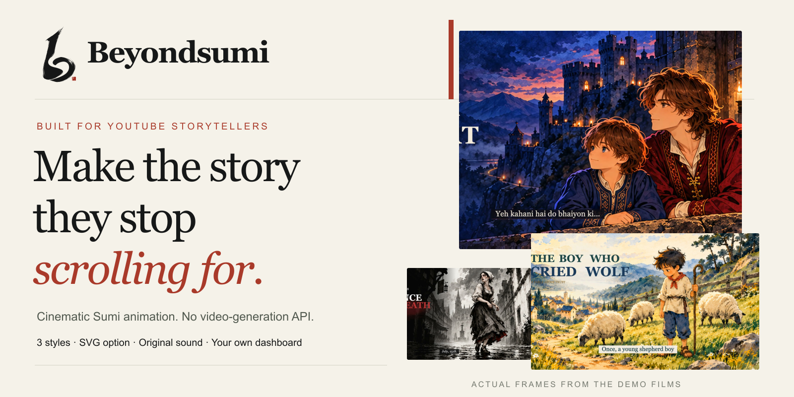
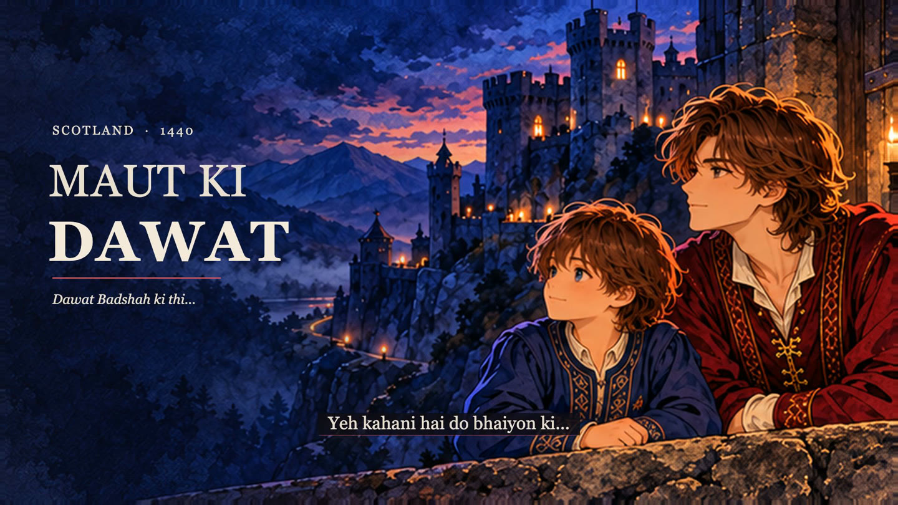
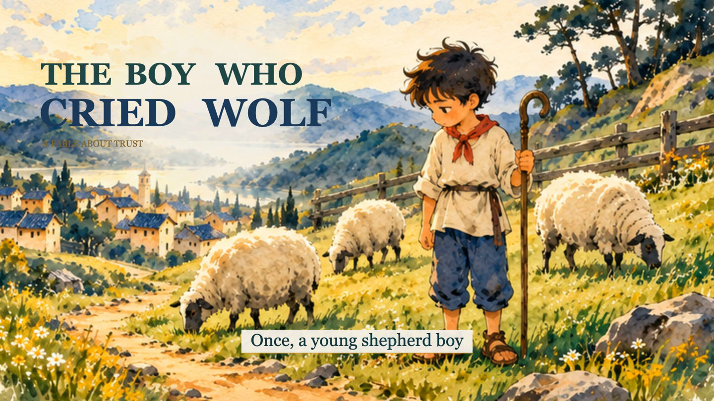
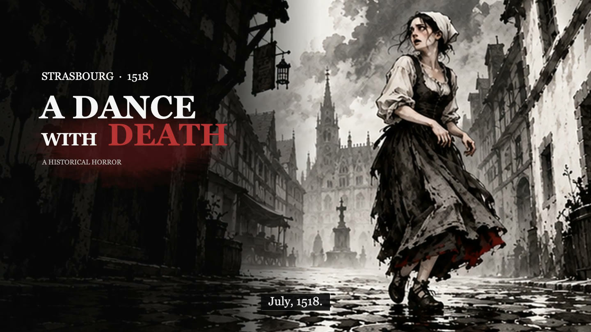
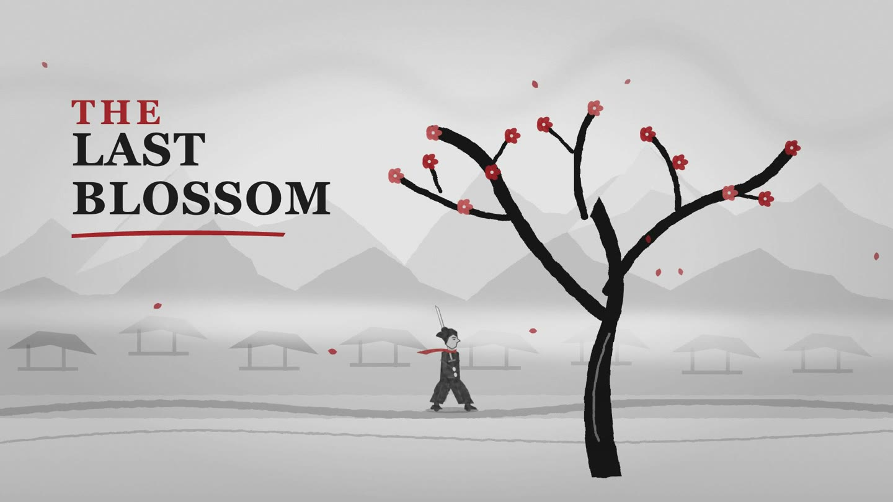

<p align="center"></p>

<h1 align="center">Beyondsumi</h1>
<p align="center"><strong>Cinematic Sumi storytelling for YouTube automation.</strong><br>Turn your idea into a directed animated film with character performance, narration, music and SFX—without a video-generation API.</p>
<p align="center"><a href="https://beyondtahir.github.io/beyondsumi/">Explore the showcase</a> · <a href="https://beyondtahir.github.io/beyondsumi/#films">Watch 4 demos</a> · <a href="https://github.com/beyondtahir/beyondsumi/releases/latest">Download</a> · <a href="INSTALL.md">Install</a> · <a href="skills/sumi/references/beginner-use.md">How to use</a></p>

**Three art styles. An optional SVG route. Twelve original music themes. A local sound engine. Your own branded film dashboard.**

Beyondsumi works with a capable AI assistant. Bring an idea, a written story or your recorded narration. The assistant helps write an engaging hook and emotional script, directs complete scenes and camera movement, prepares artwork/action poses, animates the film and builds a story-shaped soundtrack. You review the script and direction before production. Only your chosen edition is made.

## Watch the films

The [showcase has four interactive demo tabs](https://beyondtahir.github.io/beyondsumi/#films). The selected finished films are separate release assets; private working projects and raw narration are not included.

| Style / route | Purpose | Watch |
|---|---|---|
| **Sumi Original** — Maut Ki Dawat | Painted Sumi Anime, richer character acting and emotional depth. Historical drama demo, 1:30, Roman Urdu. | [Watch Original](https://beyondtahir.github.io/beyondsumi/#watch-original) |
| **Sumi Light** — The Boy Who Cried Wolf | Colourful brush-and-ink stories, fables, romance, children’s tales and documentaries. 0:46, English. | [Watch Light](https://beyondtahir.github.io/beyondsumi/#watch-light) |
| **Sumi Dark** — A Dance With Death | Horror, mystery and dark stories with bold ink, selective red and cinematic reveals. 1:20, English. | [Watch Dark](https://beyondtahir.github.io/beyondsumi/#watch-dark) |
| **SVG in Sumi Dark** — The Last Blossom | Vector artwork and animation **without an image-generation or video-generation API**. 0:15, captions/music/SFX. SVG is an artwork route, not a fourth style. | [Watch SVG](https://beyondtahir.github.io/beyondsumi/#watch-svg) |

[](https://beyondtahir.github.io/beyondsumi/#watch-original)

<details><summary><strong>See the Light, Dark and SVG demo artwork</strong></summary>

[](https://beyondtahir.github.io/beyondsumi/#watch-light)

[](https://beyondtahir.github.io/beyondsumi/#watch-dark)

[](https://beyondtahir.github.io/beyondsumi/#watch-svg)

</details>

## What is Sumi art?

Sumi-e is Japanese ink painting, associated with expressive brushwork, tonal washes and meaningful open space. Beyondsumi adapts that spirit into painted and brush-built animated storytelling. Original, Light and Dark have distinct art/motion treatments; palette and direction follow the story. [Explore the art and styles](https://beyondtahir.github.io/beyondsumi/#art).

## Made for storytelling channels

Create emotional stories, fables, children’s tales, historical dramatizations, documentaries, horror and mysteries. Your assistant can help write the story first, direct narrator/character dialogue, use supported lip-sync, and build an ending that resolves the hook. [Story-writing guide](skills/sumi/references/story-writing.md).

The workflow supports original, creator-directed YouTube storytelling. YouTube controls monetization eligibility and reviews channels/content under its policies; software does not issue platform approval or guarantee earnings. [YouTube policies](https://support.google.com/youtube/answer/1311392).

## Why it can be inexpensive

Prepared images, complete action states, supported small movements and reusable assets are animated locally. There is no video-generation API charge. SVG can also avoid image-generation calls. Python composes and mixes local music/ambience/effects.

**Creator estimate: about US$0.92 for a 10-minute video.** This is Tahir’s supplied working estimate from his experience, not a fixed service price. Assistant/image/narration choices, usage and local resources determine the actual total.

## Sound is part of the story

- **12 original Python themes:** tender, love, grief, hope, wonder, journey, documentary, mystery, suspense, dread, battle and resolve; editable scores and parts included.
- **Local composer, SFX synthesizer and mixer:** the assistant interprets the story into a mood/ambience/contact cue plan, and Python renders it. It is not a separate language model that infers every sound from prose.
- **Library or Python-only:** reuse suitable user-owned sounds or make fresh local sound. Optional ElevenLabs SFX is offered for a missing effect only after approval.
- **Scene coverage:** music state, ambience/intentional quiet and important SFX; contact timing, audible lead-ins, meaningful stops and speech duck/recovery. Actual listening remains part of review.

[Listen to the sound lab](https://beyondtahir.github.io/beyondsumi/#sound) · [Sound routing](skills/sumi/references/sound-routing.md).

## Choose your narration

1. [ElevenLabs](https://elevenlabs.io): connect an account and choose a supported voice/model. Approve paid usage before generation.
2. [Voicebox](https://github.com/jamiepine/voicebox): optional free/open-source local narration app; selected models have their own requirements/licenses.
3. **Your own voice:** record the story and send it. The assistant plans scenes, captions and sound around the original performance.
4. **No narration:** retain readable story captions and let music/ambience/SFX lead.

Multilingual story development uses your chosen assistant. Spoken languages depend on the voice model; 80+ language workflows need compatible models. Hindi, Urdu, Arabic and English are examples, not a claim that every Voicebox engine supports all of them. [Narration routes](skills/sumi/references/narration.md).

## Your film has its own dashboard

Each requested film is delivered as an **HD H.264/AAC MP4**, editable source and a branded watch/download dashboard. See all three editions; unmade editions prepare agent-neutral requests without secretly starting production. A local dashboard needs its local server. [Try the public dashboard demo](https://beyondtahir.github.io/beyondsumi/dashboard/).

## Install and make your first film

1. [Download the latest release](https://github.com/beyondtahir/beyondsumi/releases/latest) and extract it.
2. Open [INSTALL.md](INSTALL.md) and choose your actual assistant: Codex, Claude Code, Kimi Code CLI, Gemini CLI, OpenClaw, Hermes or ChatGPT/chat-app route.
3. Follow [the simple usage guide](skills/sumi/references/beginner-use.md). Setup checks available tools and explains missing items before installation, model downloads or paid calls.
4. Give your idea, duration and preferred telling mode. Review the script and direction, approve the scope, then review the animated proof and final film.

Paste this into your assistant after setup:

```text
Use Beyondsumi. I’m a beginner.
Help me make a 30-second story about [my idea].
Ask whether I want narration, dialogue or both.
Show me the script and direction before production.
Make the music, ambience and SFX part of the story.
```

Assistant names do not guarantee image tools or local execution. [Compatibility and exact test scope](COMPATIBILITY.md) distinguishes installer checks from native generation. Windows/account uploads and every-host execution are not universally certified.

## Created by Beyond Tahir

Beyondsumi was created by **Muhammad Tahir Ashraf (Beyond Tahir)** for people building distinctive YouTube storytelling channels. The goal: a story-first creative workflow with an identifiable art style, purposeful cinematography and sound, and practical local tools.

[BeyondTahir.com](https://beyondtahir.com) · [GitHub](https://github.com/beyondtahir) · [Share feedback](https://github.com/beyondtahir/beyondsumi/issues)

## License and source scope

First public release **1.0.0**. Code uses the root MIT license with preserved adjacent third-party notices. Original bundled Python audio has its own included permission. Finished demo films are examples and do not license extraction of separately licensed voice/effect sources. Dependencies, optional apps/models and imported media retain their own terms. [LICENSE](LICENSE) · [THIRD-PARTY.md](THIRD-PARTY.md).
